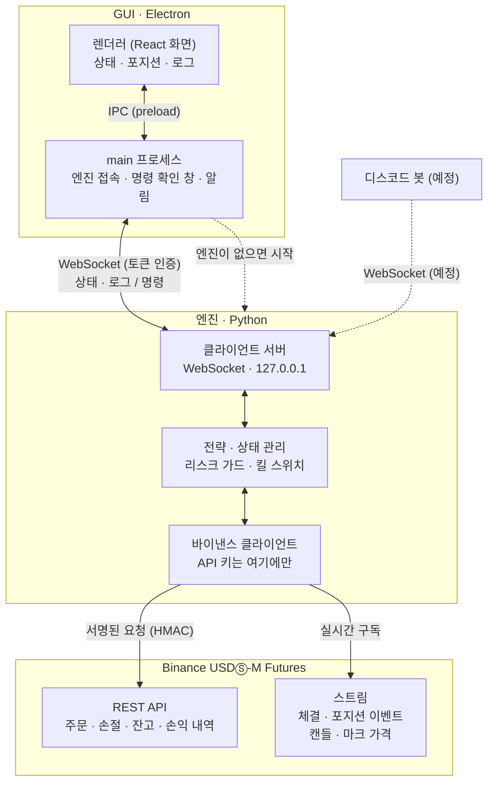
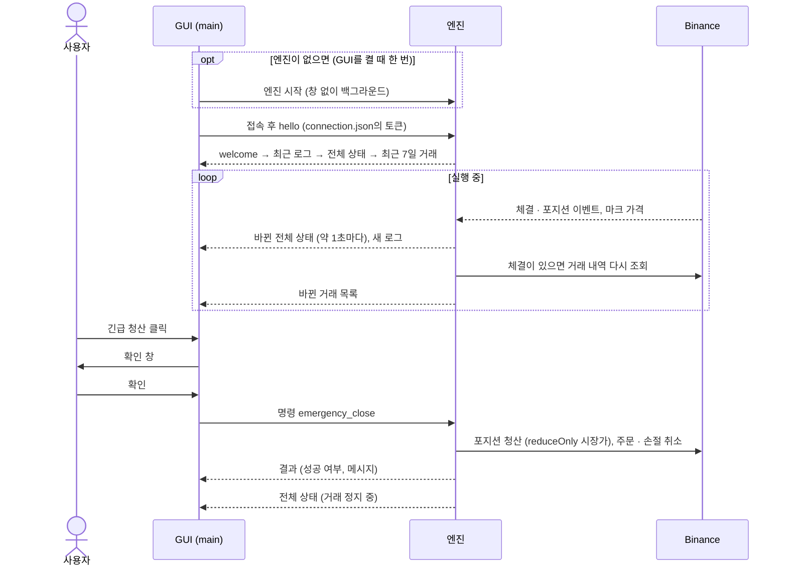

# QuantDeck

바이낸스 USDⓈ-M 선물을 대상으로 하는 개인용 퀀트 자동매매 시스템입니다.
Python 매매 엔진이 전략 판단과 주문을 담당하고, Electron 데스크톱 앱은 엔진을 감시하고 제어하는 조종석 역할을 합니다.

> **현재 상태:** 초기 개발 단계입니다. GUI는 엔진을 띄우고 멈출 수 있고, 엔진의 상태·포지션·로그를 보여주며, 긴급 청산과 거래 정지 해제 명령을 보낼 수 있습니다. 코인을 추가·제거하고 코인마다 전략·파라미터·레버리지를 바꿀 수도 있습니다. 체결, 거래 정지, 손실, 가격 같은 알림을 화면 오른쪽 아래 팝업으로 띄우고, 창을 닫으면 트레이에서 계속 실행됩니다. 엔진은 바이낸스 테스트넷 연결, 사용자 데이터 스트림 수신, 주문 실행(진입, `reduceOnly` 청산, 거래소 손절), 일일 손실 한도·진입 게이트·킬 스위치까지 구현되어 있습니다. 백테스트 명령(`quantdeck-engine backtest`)으로 전략을 메인넷 과거 데이터에 돌려 볼 수 있고, 그 결과로 첫 전략(BTCUSDT 4시간봉 돈치안 채널 돌파)을 골랐습니다. 상주 엔진(`quantdeck-engine run`)은 설정 파일에 적힌 전략을 캔들이 닫힐 때마다 판단해 진입·청산합니다. 테스트넷 포워드 테스트는 2026-10-19에 시작했습니다.

> **주의:** 이 프로젝트는 개인 학습 및 연구 목적입니다. 선물 거래는 레버리지로 인해 원금 이상의 손실이 빠르게 발생할 수 있습니다. 모든 기능은 테스트넷에서 충분히 검증한 뒤 사용하세요. 이 코드는 투자 조언이 아니며, 사용으로 인한 손실은 사용자 본인의 책임입니다.

---

## 주요 기능 (계획)

- **매매 엔진:** 실시간 시세 수신, 전략 신호 판단, 주문 실행, 포지션 및 리스크 관리
- **백테스트:** 실전 엔진과 동일한 전략 코드로 과거 데이터 검증
- **데스크톱 GUI:** 포지션·손익·엔진 로그 모니터링, 봇 시작/정지, 긴급 청산, 전략 설정
- **디스코드 봇:** 상태 조회 및 정지·청산 명령
- **기록:** 거래 내역, 주문 로그, 일별 손익 저장

## 아키텍처

엔진과 GUI는 별도의 프로세스로 실행됩니다. GUI를 닫아도 엔진은 계속 동작하며, 매매 판단과 바이낸스 접속은 항상 엔진에서만 이루어집니다.



- **GUI ↔ 엔진:** GUI의 main 프로세스가 `engine/state/connection.json`에서 포트와 토큰을 읽어 `127.0.0.1`의 엔진에 WebSocket으로 접속합니다. 포트와 토큰은 엔진을 시작할 때마다 바뀝니다. 화면(렌더러)은 토큰을 모르고, preload가 열어 둔 함수로만 main과 통신합니다.
- **엔진 ↔ 바이낸스:** API 키는 엔진만 가지고 있습니다. 주문과 조회는 서명한 REST 요청으로 보내고, 체결·포지션 변화와 마크 가격은 스트림으로 받습니다. 손절 주문은 거래소에 걸려 있어서 엔진이 멈춰도 동작합니다.

GUI가 엔진에 접속해 상태를 받고, 긴급 청산 명령을 보내는 흐름입니다.



## 디렉터리 구조

```
quantdeck/
├─ gui/          # Electron + React + TypeScript 데스크톱 앱
├─ engine/       # Python 매매 엔진
├─ bot/          # 디스코드 봇 (예정)
├─ docs/         # 설계 문서, memory-bank
├─ .env.example  # 환경 변수 템플릿
└─ README.md
```

## 기술 스택

| 구성 요소 | 기술 |
| --- | --- |
| GUI | Electron, React, TypeScript, electron-vite, lightweight-charts |
| Engine | Python |
| 데이터 저장 | SQLite (거래 기록, 로그), 과거 캔들은 바이낸스에서 받은 zip 파일 그대로 (데이터가 커지면 Parquet) |
| 통신 | WebSocket (엔진 ↔ GUI, 엔진 ↔ 봇) |
| 거래소 | Binance USDⓈ-M Futures |

## 시작하기

### 요구 사항

- Node.js 22 이상
- npm 11 이상
- Python 3.12 이상, [uv](https://docs.astral.sh/uv/) (엔진)

### GUI 실행

```bash
git clone https://github.com/Epsilonely/quantdeck.git
cd quantdeck/gui
npm install
npm run dev
```

GUI를 켜면 실행 중인 엔진(`quantdeck-engine run`)에 접속합니다. 엔진이 없으면 창 없이 백그라운드로 직접 띄우고, 이미 실행 중이면 그대로 둡니다. 엔진은 GUI의 "엔진 정지" 버튼으로 멈추고 "엔진 시작" 버튼으로 다시 띄웁니다. GUI를 닫아도 엔진은 계속 돌며, 엔진이 도중에 멈춰도 GUI가 저절로 다시 띄우지는 않습니다. GUI가 엔진을 띄우려면 먼저 아래 [엔진 실행](#엔진-실행)대로 `uv sync`와 설정 파일을 준비해야 합니다.

심볼 표의 "코인 추가" 버튼이나 각 코인의 "변경" 버튼을 누르면 표 아래에 설정 패널이 열립니다. 레버리지, 전략, 봉 간격, 파라미터를 고르면 GUI의 main 프로세스가 실제로 보낼 내용(추가, 또는 바뀌기 전 → 후)을 확인 창에 보여주고, 확인한 경우에만 엔진에 보냅니다. 전략 목록과 파라미터 기본값은 엔진이 접속 때 보내 주므로, 이를 보내지 않는 옛 엔진에 붙으면 설정 패널이 꺼집니다. 전략을 붙이거나 바꾸면 엔진이 최근 마감 캔들로 바로 판단해 진입할 수 있습니다. 포지션이 열린 코인은 엔진이 변경과 제거를 거부하므로 패널에서도 막아 둡니다.

화면에는 엔진 상태, 일일 손실, 잔고, 심볼별 레버리지·전략·포지션·손절·주문과 전략이 마지막으로 판단한 캔들·신호가 나옵니다. 엔진 로그는 헤더의 "엔진 로그" 버튼으로 여는 별도 창에 나옵니다. 그 창을 닫아 두거나 최소화한 동안 경고나 오류가 오면 버튼에 개수가 표시됩니다. 엔진에 보내는 명령은 모두 확인 창을 거칩니다. 확인 창은 GUI의 main 프로세스가 앱 창 위에 겹쳐 띄우는 별도 화면이라, 화면(렌더러) 코드에 버그가 있어도 확인 없이 명령이 나가지 않습니다. 테마를 따르고, 기본 선택은 "취소"이며 Esc로 닫힙니다. 지금은 소스에서 실행할 때(`npm run dev`)만 엔진 폴더를 찾습니다.

코인 하나만 멈추려면 심볼 표 상태 칸의 버튼을 씁니다. "일시정지"는 그 코인의 새 진입만 막고, 포지션·거래소 손절·전략의 청산 신호는 그대로 둡니다. "청산·정지"는 포지션이 있을 때 나오며, 먼저 진입을 막은 뒤 포지션을 시장가 `reduceOnly`로 청산하고 남은 손절 주문을 취소합니다. 다른 코인은 계속 거래하고, 이 청산의 손익도 일일 손실 한도에 들어갑니다. 일시정지는 엔진을 재시작해도 유지되며 "재개" 버튼으로 풉니다. 재개는 사용자가 건 일시정지만 풀고, 엔진이 스스로 건 정지(손절 실패 등)는 그대로 둡니다.

### 엔진 실행

상주 엔진, 두 점검 명령, 킬 스위치 해제 명령, 백테스트 명령이 있습니다. 먼저 아래 [환경 설정](#환경-설정)대로 `.env`와 `engine/config.toml`을 준비하세요.

```bash
cd quantdeck/engine
uv sync
uv run quantdeck-engine check
```

`check`는 조회 전용입니다. 서버 시간, 심볼 정보, 포지션 모드, 잔고, 포지션을 조회하고 캔들 스트림을 몇 개 받은 뒤, 사용자 데이터 스트림에 연결되는지 확인하고 종료합니다. 주문은 내지 않습니다.

```bash
uv run quantdeck-engine run
```

`run`은 Ctrl+C나 GUI의 엔진 정지 버튼으로 멈출 때까지 도는 상주 엔진이며, 지금은 **테스트넷 전용**입니다. 시작할 때 심볼마다 마진 모드·레버리지를 맞추고, 손절 없이 남아 있는 포지션에는 비상 손절을 겁니다. 실행 중에는 계좌 이벤트를 따라가며 일일 손실을 주기적으로 확인하고, 한도에 닿으면 킬 스위치를 발동합니다. 새 진입은 오늘 손실에 이미 열린 모든 포지션이 손절될 때의 손실을 더해도 일일 한도를 넘지 않는 만큼만 들어가며, 여러 심볼의 진입은 한 번에 하나씩 처리합니다.

거래할 심볼과 심볼마다의 레버리지·전략은 `engine/state/symbols.json`에 있습니다. 이 파일은 엔진만 쓰며, 처음 `run`할 때 `engine/config.toml`의 `[symbols]`와 `[strategy]`로 만들어집니다. 그 뒤로는 두 표를 읽지 않으므로 지워도 됩니다. 엔진이 도는 중에 클라이언트 명령(`set_symbol`, `remove_symbol`)으로 심볼을 추가·제거하고 전략·파라미터·레버리지를 바꿀 수 있습니다. 엔진은 값을 코드의 상한으로 다시 검사하고, 그 심볼에 포지션이 열려 있으면 거부합니다. 바뀐 심볼에만 적용하며 엔진을 재시작하지 않습니다. GUI에서는 심볼 표 아래의 설정 패널로 이 명령을 보냅니다([GUI 실행](#gui-실행)). 코인별 일시정지(`pause_symbol`, `close_symbol`, `resume_symbol`)도 이 파일의 해당 심볼 항목에 `paused_at`으로 저장됩니다.

전략이 있는 심볼은 시작할 때(또는 전략을 붙이거나 바꿀 때) REST로 워밍업 캔들을 받아 가장 최근 마감 캔들부터 판단하므로, 엔진이 꺼져 있던 사이에 나온 청산 신호도 놓치지 않습니다. 그 뒤로는 캔들이 닫힐 때마다 거래소의 포지션을 읽어 전략에 넘기고, 진입 신호면 시장가 진입 후 거래소 손절을 걸고, 청산 신호면 `reduceOnly`로 청산합니다. 거래 정지 중에는 진입 신호를 건너뛰지만 청산은 합니다. 판단할 때마다 `engine/data/forward/`에 캔들, 그때의 포지션, 신호, 결과를 한 줄씩 남겨, 나중에 같은 캔들을 백테스트로 재생한 결과와 비교할 수 있습니다. 파일은 심볼과 전략 설정마다 따로입니다(`BTCUSDT_4h_donchian_entry_period=55_exit_period=20.csv`). 전략이 없는 심볼은 새로 진입하지 않습니다. GUI는 `127.0.0.1`의 WebSocket으로 접속합니다. 접속 정보(포트, 토큰)는 실행 중에만 `engine/state/connection.json`에 있습니다. `run`과 `trial`은 동시에 하나만 실행할 수 있습니다.

```bash
uv run quantdeck-engine trial
```

`trial`은 **테스트넷 전용**이며 실제로 주문을 냅니다. `symbols.json`의 첫 심볼(또는 `--symbol`로 고른 심볼)로 시장가 진입 → 거래소 손절 → 손절을 지워 비상 손절이 걸리는지 확인 → `reduceOnly` 청산을 한 번 실행합니다. 이어서 다시 진입한 뒤 킬 스위치를 직접 발동해 청산·주문 취소·정지 상태를 확인합니다. 이때 정지 기록은 임시 폴더에 쓰므로 실제 엔진의 정지 상태에는 영향이 없습니다. 메인넷 설정이거나, 엔진이 정지 상태이거나, 그 심볼에 포지션이 이미 있으면 실행하지 않습니다. `--side short`, `--stop-percent 2`로 방향과 손절 거리를 바꿀 수 있습니다.

```bash
uv run quantdeck-engine lift-halt
```

킬 스위치가 발동하면 엔진은 `engine/state/halt.json`에 기록을 남기고, 사용자가 해제할 때까지 새 주문을 내지 않습니다. 원인을 확인한 뒤 이 명령으로 해제하고 엔진을 다시 시작하세요. 같은 UTC 날에는 해제해도 진입 게이트가 막으므로, 실제 거래는 다음 날(한국 시간 09:00)부터 재개됩니다.

```bash
uv run quantdeck-engine backtest --strategy donchian
```

`backtest`는 전략 하나를 메인넷 과거 데이터로 돌려 보는 명령이며 주문은 내지 않습니다. 전략은 `donchian`(돈치안 채널 돌파), `bollinger`(볼린저 밴드 평균 회귀), `daily-breakout`(일봉 시가 변동성 돌파), `move-fade`(1시간·2시간 급등락 역추세), `trend-pullback`(4시간 추세 방향의 눌림목 지정가 진입), `donchian-atr-adx`(돈치안 채널 돌파에 터틀식 ATR 손절과 ADX 필터를 더한 것, 각각 0이면 끔)가 있습니다. 과거 캔들은 바이낸스 공개 아카이브(data.binance.vision)에서 받아 `engine/data/`에 보관하고, 다음 실행부터는 받아 둔 파일을 씁니다. 수량 계산 규칙(틱, 최소 주문, 레버리지 구간)은 설정된 네트워크(기본 테스트넷)에서 읽으므로 `.env`가 필요하고, 리스크 설정은 `engine/config.toml`을 그대로 씁니다. 기본값은 BTCUSDT 1시간봉, 2020-01-01부터 어제까지, 시작 잔고 5000 USDT, 수수료 0.05%(지정가 진입은 메이커 수수료 0.02%), 슬리피지 0.02%(손절 0.05%)이며 `--symbol`, `--interval`, `--start`, `--end`, `--balance`, `--fee`, `--maker-fee`, `--slippage`, `--stop-slippage`, `--leverage`로 바꿀 수 있습니다. 전략 파라미터는 `--param entry_period=55`처럼 넘기고(참·거짓 값은 `--param long_only=true`), `--trades-csv trades.csv`를 주면 거래 내역을 파일로 남깁니다.

전략은 진입을 지정가(메이커)로 낼 수도 있습니다. `trend-pullback`은 기본이 지정가 진입이고(`--param limit_atr=0`이면 시장가), `bollinger`는 `--param limit_offset=0.5`처럼 주면 지정가로 진입합니다. 백테스트는 이를 보수적으로 체결합니다. 지정가 주문은 다음 캔들 시가에 post-only로 넣고 그 캔들이 끝나면 취소합니다. 시가에 바로 체결될 가격이면 거부된 것으로 봅니다. 가격이 지정가를 한 틱 이상 뚫고 지나가야 체결되며, 체결가는 지정가, 수수료는 메이커 수수료입니다. 체결된 캔들에서 손절가에도 닿았다면 체결 직후 손절된 것으로 봅니다. 리포트에는 지정가 주문 수와 체결·거부·미체결 수가 나옵니다. 엔진은 아직 지정가 주문을 내지 못하므로, 지정가 진입을 쓰는 전략은 심볼의 전략으로 설정할 수 없습니다.

실행 로그는 콘솔과 `engine/logs/`에 함께 남습니다. 로그 시각은 이 PC의 시간대(한국 시간)에 UTC 오프셋을 붙여 기록합니다(`2026-10-16T16:41:50.908+09:00`). 파일 이름은 시작 시각과 번호로 정해지고(`engine_2026-10-03_14-30-05_000.log`), 10MB를 넘거나 날짜가 바뀌면 새 파일로 넘어갑니다. 일일 손실 한도의 하루는 로그 시간대와 상관없이 매일 09:00(00:00 UTC)에 바뀝니다. 30일 지난 로그는 엔진을 시작할 때 지웁니다. 요청 단위 로그를 보려면 `.env`에 `ENGINE_LOG_LEVEL=DEBUG`를 넣으세요.

## 환경 설정

루트의 `.env.example`을 복사해 `.env`를 만들고 값을 채웁니다.

```bash
cp .env.example .env
```

```env
# Binance
BINANCE_API_KEY=
BINANCE_API_SECRET=
BINANCE_TESTNET=true

# Engine (선택: DEBUG, INFO, WARNING, ERROR. 비우면 INFO)
ENGINE_LOG_LEVEL=

# Discord (선택)
DISCORD_BOT_TOKEN=
DISCORD_ALLOWED_USER_ID=
```

`.env`는 `.gitignore`에 포함되어 있으며 절대 커밋하지 않습니다.

리스크 설정(거래당 리스크, 일일 손실 한도, 포지션 상한)은 `engine/config.toml`에 둡니다. 처음 거래할 심볼과 레버리지, 전략도 여기에 적어 두면 첫 `run`이 이를 `engine/state/symbols.json`으로 옮기고, 그 뒤로는 엔진 명령으로 바꿉니다. 예시 파일을 복사해서 만드세요. 이 파일도 커밋하지 않습니다. 값마다 코드에 상한이 있어서, 범위를 벗어나거나 키 이름이 틀리면 엔진이 시작하지 않습니다. 리스크 값은 사람만 고치는 이 파일에만 있어서, GUI나 엔진의 버그가 바꿀 수 없습니다.

```bash
cp engine/config.example.toml engine/config.toml
```

## 안전 원칙

이 프로젝트의 모든 코드는 다음 원칙을 따릅니다.

1. **API 키는 엔진에서만 다룹니다.** GUI(Electron main·렌더러)나 디스코드 봇으로 키를 전달하거나 번들에 포함하지 않습니다.
2. **API 키에 출금 권한을 부여하지 않으며**, 가능하면 IP 화이트리스트를 설정합니다.
3. **기본 환경은 테스트넷입니다.** 실계좌 전환은 명시적인 설정 변경으로만 가능합니다.
4. **매매 판단과 주문은 엔진에서만 수행합니다.** GUI와 디스코드 봇은 엔진에 명령을 전달할 뿐입니다.
5. **청산 주문에는 항상 `reduceOnly`를, 거래소 손절 주문에는 `closePosition`을 사용합니다.** 청산이 반대 포지션을 여는 일이 없도록 합니다. (단방향 포지션 모드 기준)
6. **손절 주문은 거래소에 미리 걸어둡니다.** 엔진이 중단되어도 손절이 실행되도록 합니다.
7. **킬 스위치를 둡니다.** 일일 최대 손실을 넘으면 모든 주문을 취소하고 포지션을 정리한 뒤, 사용자가 해제할 때까지 매매를 멈춥니다. 엔진은 모니터링을 위해 계속 실행됩니다.
8. **포지션과 잔고의 기준은 항상 거래소입니다.** 엔진 재시작 시 로컬 기록이 아닌 바이낸스 조회 결과로 상태를 복원합니다.
9. **디스코드 명령은 조회와 정지·청산 방향으로만 제한합니다.** 허용된 사용자 ID 외의 명령은 무시합니다.

## 로드맵

- [x] 레포지토리 및 GUI 뼈대 구성
- [x] memory-bank 및 프로젝트 문서 작성
- [x] Engine: 바이낸스 테스트넷 연결, 시세 수신, 포지션·잔고 조회
- [x] Engine: 주문 실행 모듈 (진입, `reduceOnly` 청산, 거래소 손절 주문)
- [x] Engine: 리스크 관리 (최대 포지션, 일일 손실 한도, 킬 스위치)
- [x] 엔진 ↔ GUI WebSocket 연결
- [x] GUI: 포지션·손익·로그 모니터링, 시작/정지, 긴급 청산
- [x] 백테스트 모듈 (실전과 동일한 전략 코드 사용)
- [ ] 첫 전략 구현 및 테스트넷 포워드 테스트
- [ ] 디스코드 봇
- [ ] 거래 기록 분석 화면

## 라이선스

All rights reserved. 저장소는 공개되어 있지만 별도의 라이선스를 지정하지 않았으므로, 저작권자의 허락 없이 코드를 복제·수정·배포할 수 없습니다.
